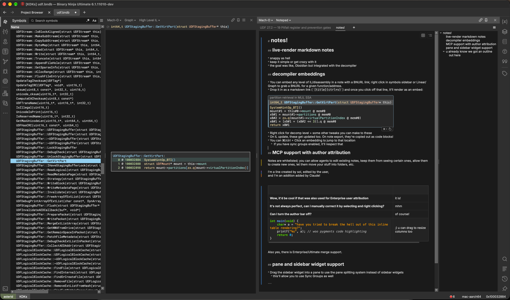
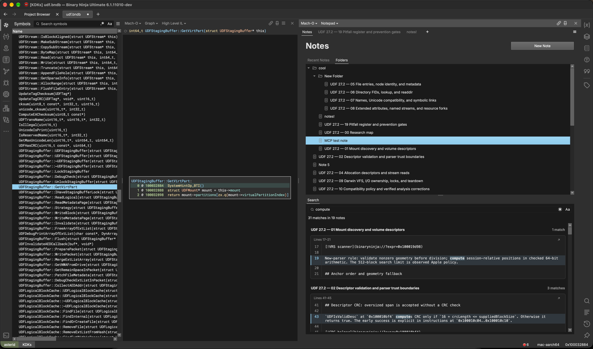
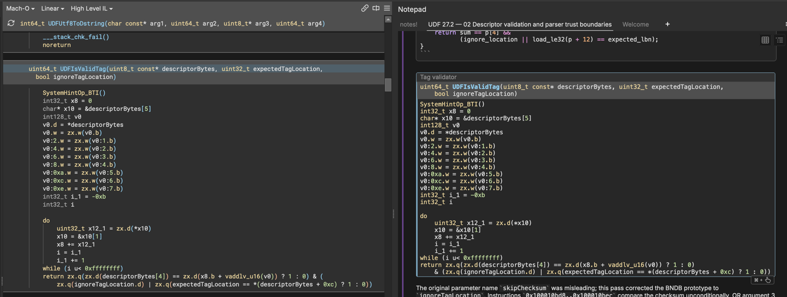
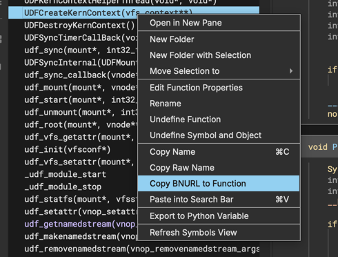
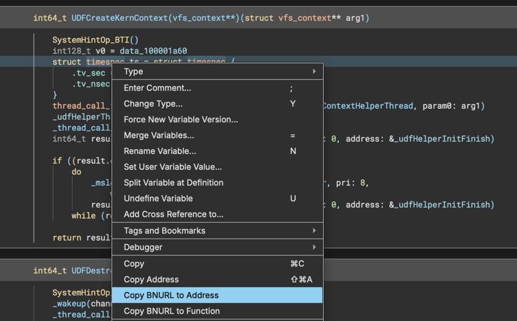
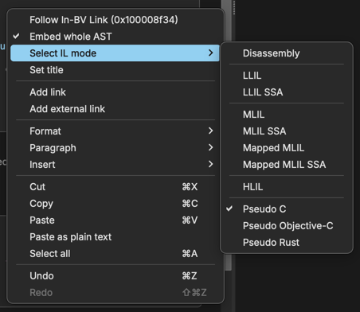
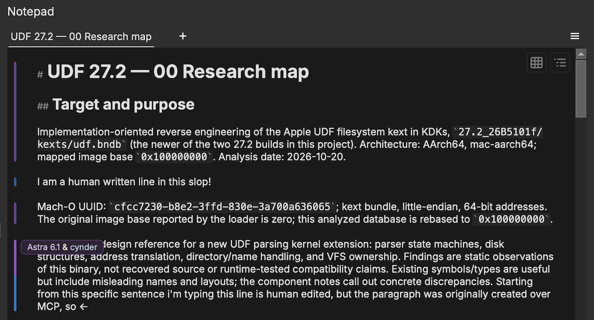
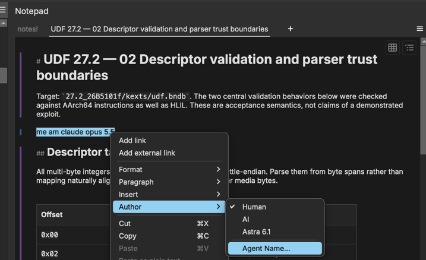

# Notes

Notes is an Obsidian-style, live-render markdown multi-note notepad plugin for Binary Ninja. 

Notes are saved in the BinaryView itself and move around with your bndbs.



* decompilation/disassembly embedding
* All The Formatting!
* Authorship tracking (for teams + agents)
* note organization (folders, etc) 
* MCP support

There is a walkthrough of the plugin on first-install, if you don't want to read all of this, don't worry. 

---

Ton of notes on a bndb? Sort 'em or search 'em if you need:  


---


## Sidebar + Pane widget

Binary Ninja has Panes, items in the middle of the app, and Sidebar Widgets. Notes implements these both.

You can drag and drop the sidebar icon into the middle of the view to open the paned view. 

## HLIL embeddings

My usual style of taking notes (especially around decomp) typically involves a lot of "here is the relevant decompilation/code". 
I wanted a feature that'd allow me to dynamically link to particular decompilation snippets and embed their
contents in the view. 

So we use BNURLs for this (these are hotlinks that the binaryninja app can open, we're repurposing them for this.)

`[!Tag validator](binaryninja://?expr=UDFIsValidTag)` will expand into: 

Using the `!` at the start of the embed title will embed the entire function. 



These get exported as code blocks. 

You can easily grab a link to a function in the symbols view:  


or from Linear/Graph, you can grab an address or function link  


You can control the IL level of displayed embeds by right clicking the embed in the note view.



In text that's represented by the note title, e.g. `[!VAT mapping](binaryninja://?expr=0x10002c5b4 "asm")`

You can also "Embed whole AST"; this will embed the entire function, among other things.

---

## MCP Integration

This isn't just a patch tool -- it's a command center (sry) 

I've done MCP integration in this because sometimes its nice to roll up to a bndb with
a little tour guide or pregenerated map of where something i've asked about is.

Combined w/ HLIL embeddings and such, this should hopefully give agents enough to be useful w/ this plugin. 

There are very granular access controls. 

This integrates w/ the official binaryninja MCP. 

## Enterprise

Hi! This will do its best to deconflict on syncs and will fall back to git conflict semantics in the note when it cannot merge them.

real-time sync is an entirely different problem. I can't exactly extend the functionality of the server, easily, but if you're 
one of the people who needs this, give me a shout; it is technically a solvable problem. 


## Authorship tracking

I strongly believe in the sanctity of human written prose, as a memory aid and just in general.

On top of that, for Enterprise teams, it can be helpful to know who wrote what.

You can toggle the bar in plugin setup, Settings, or w/ Ctrl/⌘+P "Toggle Author Bar"



Notes does its best to keep track of authorship per line, going so far as trying to distinguish when one person wrote a line
and another tweaked it. 

This can help you scan through the actually readable prose in the midst of a file that contains automated
analysis. 

### manual override

Obviously, this is not a perfectly solvable problem, so you can manually edit the author(s) of a line. 



---

## Install

Install it from Binary Ninja's plugin manager.

To install by hand, clone it into your plugins folder (command palette → **Open Plugin Folder**), install the packages in `requirements.txt` with **Install Python3 Module** (also in the command palette), then restart Binary Ninja.

```shell
# macOS
git clone https://github.com/0cyn/notes ~/Library/Application\ Support/Binary\ Ninja/plugins/notes
# Windows / Linux: into the folder Open Plugin Folder shows
git clone https://github.com/0cyn/notes "<plugins folder>/notes"
```

Without git, download the repo's zip and extract it into the plugins folder.

### license

MIT, however note that LLMs were used as this relates to copyright, etc.

### workflow

for large components of this, a qwen 3.8 flash next q4-k-(xl/s) w/ image was fine for working on it. 

big boy models also touched some of the more delicate things that I can't let get fucked up, but weren't critical enough
to handle myself. This was not an upskilled project; it was based on an unfinished C++ plugin from 2023, and there was heavy oversight and direction. 
There were reasons it was unfinished, though; the amount of LOC in this project should indicate the complexity of some of
the features, and how hard it is to be performant in Pyside. 

i'm being very nice and uploading tools/ and AGENTS.md which contains a big set of python tools
that get used to remote-pilot, scrape runtime info, and grab screenshots from a running binaryninja instance. 


